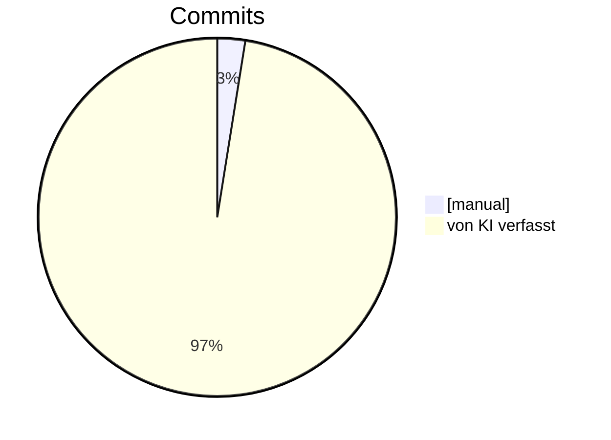

## Haben wir das Produkt wirklich zu 100% mit KI entwickelt?

- technically no -> von uns kamen die Ideen und die Nachsteuerung

## Aber habt ihr den Code zu 100% generiert?

- fast. Wir mussten ein paar Mal helfen bei Library Schwierigkeiten.
- 10 aus 397 haben wir mit `[manual]` getaggt, also sind es ca. 97,5%.

