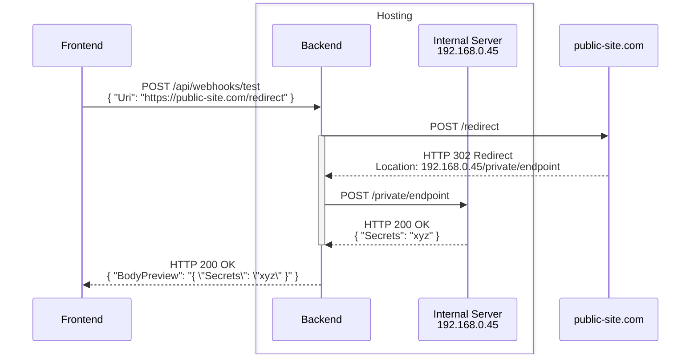

<style scoped>
div.mermaid {
  height: 100%;
  width: 90%;
}

g rect.rect {
  stroke: var(--bh-primary-blue) !important;
}
</style>



---
layout: center
---

# Probleme

```csharp
[Fact]
public async Task PostTest_WithRedirectToPrivateIp_ShouldBeBlocked()
{
  // Arrange
  this.MockWebhookClient.SendAsyncFunc = (definition, _) => {
    if (new Uri(definition.Url).Host == "public-site.com")
      // redirect to a private ip
    else
      // ok-response
  };
  var request = new WebhookDefinition(Url: "https://public-site.com/redirect", Headers: [],  Payload: "");

  // Act
  var response = await this.httpClient.PostAsJsonAsync(
    "/api/webhooks/test",
    request);

  // Assert
  response.StatusCode.Should().Be(HttpStatusCode.BadRequest);
}
```

---
layout: center
---

```log
[xUnit.net 00:00:27.88]
  IntegrationTests
    .WebhookTestEndpointTests
    .PostTest_WithRedirectToPrivateIp_ShouldBeBlocked [FAIL]
[xUnit.net 00:00:27.88]
  Expected the enum to be  HttpStatusCode.BadRequest {value: 400},
  but found  HttpStatusCode.OK {value: 200}.
```

---
layout: image

image: /images/registration-public-site-com.png

backgroundSize: 80%
---

<arrow v-click x1="450" y1="420" x2="310" y2="448" color="var(--bh-dark-blue)" width="2" />

---

# Fix - DNS hinter interface -> Mocking im Test möglich
Logik
```diff
+public interface IDnsService
+{
+    Task<IPAddress[]> GetHostAddressesAsync(string hostNameOrAddress, CancellationToken cancellationToken);
+}
```

```diff
-    var ips = await Dns.GetHostAddressesAsync(host, cancellationToken);
+    var ips = await this.dnsService.GetHostAddressesAsync(host, cancellationToken);
```
Test
```diff
+    this.MockDnsService.HostAddresses["public-site.com"] = [this.SomePublicIP];
```

```diff
-    response.StatusCode.Should().Be(HttpStatusCode.BadRequest);
+    response.Should().Be200Ok();
+    var testResponse = await response.Content.ReadFromJsonAsync<WebhookTestResponse>();
+    testResponse!.Attempts.Should().ContainSingle()
+        .Which.Error!.ToLower().Should().ContainAll(["redirect", "private"]);
```